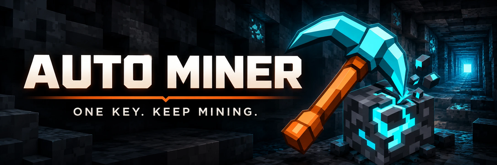

# Auto Miner

*English | [Français](README.fr.md)*



[Information site](https://jason54jg.github.io/MiningMod/) · [Modrinth](https://modrinth.com/mod/auto-miners) · [Site deployment](site/README.md) · [Modrinth presentation](modrinth/README.md)

Fabric mod for Minecraft **26.1 – 26.3** that digs a straight tunnel automatically: a key toggles mining, the player advances while breaking the blocks in front of them, and systematically breaks any ore touching the tunnel.

Current version: **0.0.48** (see [CHANGELOG.md](CHANGELOG.md))

## Features

- **B** key (rebindable in the game's options) to toggle automatic mining on/off — a colored chat message confirms it every time ("Auto-mining enabled" in green, "disabled" in red).
- Once enabled, the mod:
  - breaks the blocks in front of the player (head first, then feet — the crosshair points at the head), in the direction locked in at activation ;
  - moves the player forward through the tunnel once it's clear ;
  - **ore exception**: an ore (vanilla or the `c:ores` tag, for compatibility with other mods) touching the tunnel is broken before continuing, even if it's not exactly on the drilling axis. The **mandatory block**, on the other hand, is detected within range all around the player (front, back, sides, above, below), not just when it touches the tunnel.
  - the player has nothing left to do once it's active: the mod fully drives both movement **and** the camera, no movement or aiming is needed.
- Mining follows normal breaking rules (tool, block hardness, drops, XP): this is not instant-break in survival.
- Stops automatically on an unbreakable block (bedrock, etc.) or a liquid: after ~1s without breaking or advancing, mining shuts itself off and alerts the player (sound + flash) instead of staying silently stuck.
- **Configurable for non-vanilla servers** (`/autominer` or the Mod Menu button):
  - `Reach`, `Blocks/tick`, `Y level` and `Tunnel width` are free-text fields (any value, not just presets) ;
  - `Reach`: how far ahead the tunnel is anticipated and ore is detected (useful if the player has extended reach from another mod/ability) ;
  - `Blocks/tick`: number of blocks that can be broken in a single tick (useful with haste/efficiency or a multi-instant-break ability) ;
  - `Lock Y level` + `Y level`: the tunnel stays at the chosen height instead of the one where mining was activated. The mod automatically descends (breaks the block underfoot, waits to land, repeats) to that layer before digging horizontally — not real pathfinding, just a controlled vertical descent, which stops dead on an unbreakable block or a liquid.
  - `Tunnel width`: widens the mined area sideways (useful with a tool that has its own area effect, or just to dig wider).
  - **"Mandatory block" slot**: aim at the block you want in the world, then open `/autominer` and click the slot — designates that custom block as mandatory to break as soon as it's detected in range, wherever it is around the player (unlike vanilla ores, limited to what touches the tunnel). Useful on a modded server with its own resource blocks.
  - **Obstacles** tab (smart navigation): bypass, step down one block, detection reach — useful when an AOE pickaxe clears a large area and leaves the bot stuck.
  - `HUD position X`/`HUD position Y`: moves the mining HUD panel (top-left by default) wherever you want on screen, in pixels.
  - Tabbed screen with **Save** / **Cancel** (Escape = cancel without saving).
  - Settings saved to `config/autominer.json`, including the chosen tool and mandatory block (`toolItemId` / `customBlockId`).
- **Teleport/mention alerts** (active only while mining is running): a sound (ding) and a red screen flash for 3 seconds trigger if:
  - the player moves abnormally in a single tick (teleport, admin TP, etc.) ;
  - the player's name appears in a received chat message (mention).
- Straight-line mining only: the direction is locked in at activation (never tied to the live look direction again) and the camera stays fixed on it as long as mining is running.
- The bot doesn't walk into thin air **if `Lock Y level` is active** (and the player isn't flying): with no floor ahead (hole, ravine), it jumps over a 1-block-wide hole, otherwise it stops instead of falling. Without the lock, or while flying in creative/spectator, there's no height to maintain: it ignores holes and keeps going straight ahead regardless of the floor — the block in front of it, if any, is still broken normally either way.
- The block holding the player up is never broken, even if it matches an ore/mandatory block detected right underfoot — avoids falling into the void by mining its own floor.
- **"Release mouse" key** (`key.autominer.ungrab`, `N` by default): prevents an unintentional mouse movement from turning the camera (and therefore the mining direction) while the bot is working. A chat message confirms it every time, and a reminder stays on screen for as long as the mouse remains released.
- **Tool slot** (config screen): clickable slot that captures the item currently held by the player as the mining tool; the mod automatically equips it from the hotbar before mining. Saved to config when you click **Save**.
- **Mining HUD** (top-left corner, visible while mining is active):
  - time elapsed since activation ;
  - total number of blocks broken ;
  - breakdown by ore type broken (deepslate variants are merged with the base ore).
- **Localized UI**: config screen, HUD and chat messages follow the client's game language (English by default, French provided) via Minecraft's own translation system — same as the keybind names. Tool/mandatory-block names use Minecraft's own localized item/block name.

## Requirements

- Minecraft **26.1 – 26.3** (one jar per version, built with [Stonecutter](https://stonecutter.kikugie.dev/))
- [Fabric Loader](https://fabricmc.net/) `>= 0.19.5`
- [Fabric API](https://modrinth.com/mod/fabric-api) and [Mod Menu](https://modrinth.com/mod/modmenu) *(optional, for the config button in the mod list)* matching your Minecraft version:

  | Minecraft | Fabric API | Mod Menu |
  | --------- | ---------- | -------- |
  | 26.1 – 26.1.2 | `0.155.3+26.1.2` | `18.0.2` |
  | 26.2 | `0.161.0+26.2` | `20.0.1` |
  | 26.3 | `0.162.0+26.3` | `21.0.0` |

- [Fabric Language Kotlin](https://modrinth.com/mod/fabric-language-kotlin): `1.13.12+kotlin.2.4.0` (26.1/26.2) or `1.14.2+kotlin.2.4.21` (26.3)
- Java **25**

## Build

```bash
./gradlew :26.1.2:build   # Minecraft 26.1 – 26.1.2
./gradlew :26.2:build     # Minecraft 26.2
./gradlew :26.3:build     # Minecraft 26.3
```

The generated `.jar` files (`autominer-<version>+<mc>.jar`) are in `versions/<mc>/build/libs/`.

## Regression checks

```bash
bash tests/regression/run.sh
```

These scenarios exercise the mining and session logic with local Minecraft/Fabric doubles. See [test details](tests/regression/README.md). Run the three builds above as well; in-game checks remain necessary for rendering and server behavior.

## Installation

1. Install Fabric Loader for your Minecraft version (26.1, 26.2 or 26.3).
2. Place in the `mods/` folder the matching files:
   - `autominer-<version>+<mc>.jar`
   - `fabric-api-<version>.jar`
   - `fabric-language-kotlin-<version>.jar`

## Project structure

```
src/
├── main/kotlin/...    # Shared data/logic (config, stats, mod initializer) — no client-only classes
├── client/kotlin/...  # AutoMiner, keybinds, HUD, screens (everything touching Minecraft/LocalPlayer/rendering)
└── main/resources/    # lang files (shared)
versions/
├── 26.1.2/            # gradle.properties + fabric.mod.json (~26.1) for Minecraft 26.1 – 26.1.2
├── 26.2/              # gradle.properties + fabric.mod.json (~26.2)
└── 26.3/              # gradle.properties + fabric.mod.json (~26.3)
```

Version-specific API differences (SDL key constants on 26.3, `setScreen` on 26.1) are handled with Stonecutter `//?` conditions directly in the shared sources.

## Versioning

Each new feature/change request bumps the version by `0.0.1` (`0.0.1` → `0.0.2` → `0.0.3`, ...). Details of each version are in [CHANGELOG.md](CHANGELOG.md).

## License

[MIT](LICENSE)
